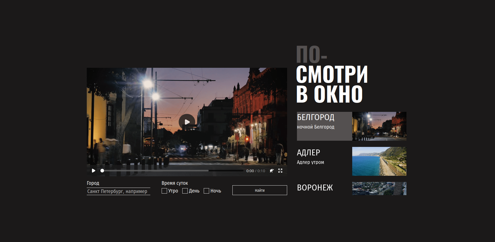

https://github.com/artm8088-gif/posmotri-v-okno-ad

# Посмотри в окно — README

Готовое приложение: HTML и JS не менялись. Написан только CSS по макету.

## Сделано
- Лейаут: две колонки (грид + флекс).
- Размеры видео, карточек, отступов.
- Тексты: шрифты, интерлиньяж, обрезка «…».
- Форма: кастомные чекбоксы, поле ввода, фокус.
- Кнопки: стили + :hover/:active/:focus-visible.
- Карточки: фон выбранной, наведение, фокус.
- Прелоадеры поверх видео и списка (position: relative).
- Доступность: visually-hidden, :focus-visible, cursor: pointer.

